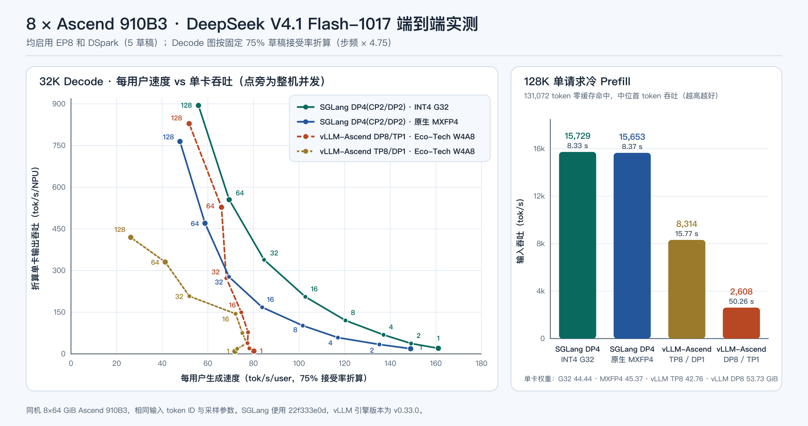

# 在 Ascend 910B 上运行原生 MXFP4 的 DeepSeek V4.1 Flash

这套适配在单机八张 Ascend 910B 上加载原始 DeepSeek V4.1 Flash checkpoint。路由专家以 **MXFP4 压缩格式**常驻 NPU，由 Ascend C grouped GEMM 在计算时解码当前权重 tile。部署验证使用八张 64 GiB 的 910B3 和 1017 checkpoint。[模型权重](https://huggingface.co/deepseek-ai/DeepSeek-V4.1-Flash-1017) · [模型技术报告](https://arxiv.org/html/2609.19969)

## 适配脉络

### 权重驻留与算子实现

模型骨干有 552B 参数，Engram 另有 196B 参数。EP8 将每层 384 个路由专家均分，每张 NPU 驻留 48 个压缩专家。MoE 路由按专家归组 token，grouped GEMM 解码 MXFP4 权重及 scale 为 FP16 tile，矩阵核计算 gate/up 和 down 投影，以 FP32 累加。模型前向保持压缩权重驻留，临时解码的粒度是 tile。

部分 dense 投影和 shared experts 在加载时将原始 FP8 权重转为沿 K 维分组的 INT8，每组 256 个元素。W8A16 GEMM 从显存读取压缩权重并逐 tile 反量化，输入激活和输出用 BF16。Engram 保留 FP8/E8M0 格式，两张大表由主机内存承载，合计约 189 GiB，节点内各 rank 共享。

### 长上下文与推测解码

在 910B 上，paged attention 的 QK/PV 由矩阵核计算，向量核处理 softmax、mask 和稀疏位置。主 KV 和滑窗 KV 用 BF16，Indexer 用 INT8 key 选择稀疏位置。CED 使用因果 encoder 的输出构建 decoder 的 global KV。Radix 命中时复用已缓存的全局状态，bounded SWA replay 恢复滑窗所需的局部状态。

Decode 使用 DSpark，每步最多提出五个草稿 token。Target 和 draft 都使用 NPU Graph，prefill 走 eager。大 prefill 的 MoE 工作区在 EP 路由之后按本卡实际命中的专家行数 compact，有界的小批路径用于 decode。

### Attention 和 MoE 分开并行

| Attention 配置 | Attention 请求分布 | 单组本地 prefill chunk | MoE |
| --- | --- | ---: | --- |
| DP8/TP1 | 八组，每条请求的 attention 和 KV 落在一张卡 | 4,096 | EP8 |
| DP4/TP2 | 四组，两张卡分摊 query heads 和投影，单 KV head 在组内各存一份 | 8,192 | EP8 |

DP8 把独立请求散到更多组。DP4 减少单卡承担的 query heads，同时引入组内通信。单请求长 prefill 的 attention 只使用所在组，MoE 由八卡共同计算。两个配置均使用 32,768-token 全局 chunk 预算。

### 主机扩展与设备核

CMake 在镜像构建时使用 GCC/G++ 13 编译主机扩展。DeepJIT 在启动和首次执行相应形状时，使用 CANN 编译 Ascend C 设备核。Compose 的 `deepjit-cache` 卷在重启时复用编译产物。实现目录和开发验证见[后端说明](../../../python/sglang/srt/hardware_backend/npu/dsv41/README.md)。

## 构建 Docker 镜像

在 Linux ARM64 主机的仓库根目录运行。准备 Ascend 910B 主机驱动、Docker Buildx、Compose v2、Git、`curl` 和 `sha256sum`，并确认 `npu-smi info` 能看到八张卡。模型磁盘空间约 476 GiB，主机内存还需覆盖 Engram 表、权重加载和运行开销。

```bash
bash examples/ascend/deepseek_v41/build-image.sh
```

脚本把当前 Git 提交打包为构建上下文，从公开发布源获取 ARM64 依赖并验证 SHA-256。默认依赖缓存为 `build/dsv41-deps`，可用 `DSV41_DEPS_DIR` 指向已准备好的同版本包。Dockerfile 使用 CANN 9.1.0、Python 3.12、PyTorch 2.10.0 和 `torch-npu` 2.10.0.post6，镜像标签默认为 `sglang-dsv41:910b`。`DSV41_IMAGE` 可覆盖标签，`--build-arg NATIVE_JOBS=4` 可限制主机扩展的并行编译数。[Dockerfile](Dockerfile) · [SGL Kernel NPU 依赖](https://github.com/sgl-project/sgl-kernel-npu/releases/tag/2026.9.0.post9) · [Triton Ascend 依赖](https://github.com/triton-lang/triton-ascend/releases/tag/v3.2.2)

## 启动与验证

将 `DSV41_MODEL_DIR` 设为完整 1017 checkpoint 目录。Compose 以只读方式挂载模型，默认监听 `127.0.0.1:31088`，启动 attention DP8/TP1 和 MoE EP8。

```bash
export DSV41_MODEL_DIR=/path/to/DeepSeek-V4.1-Flash-1017
docker compose -f examples/ascend/deepseek_v41/compose.yaml up -d
docker compose -f examples/ascend/deepseek_v41/compose.yaml logs -f sglang
```

用同一份 Compose 切换到 attention DP4/TP2。

```bash
DSV41_ATTN_DP_SIZE=4 docker compose -f examples/ascend/deepseek_v41/compose.yaml up -d
```

`/ready` 返回 HTTP 200 后执行生成和前缀复用检查。`DSV41_PORT` 自定义端口时，同步传给 smoke 脚本的 `--url`。

```bash
curl --fail http://127.0.0.1:31088/ready
docker compose -f examples/ascend/deepseek_v41/compose.yaml exec sglang \
  python3 examples/ascend/deepseek_v41/smoke.py --parallel-requests 4 --prefix-replay
```

## 跨会话复用 KV 前缀

叠加 [`compose.router.yaml`](compose.router.yaml) 后，每个 attention DP rank 发布本地 Radix 缓存的写入和淘汰事件。`sgl-router` 对文本请求查找可复用的最长 token 前缀，将请求定向到对应 rank。前缀未命中或命中长度相同时，默认选路由器在途请求最少的候选 rank。DP8/TP1 和 DP4/TP2 共用此配置。[DP rank 路由说明](../../../sgl-router/REFERENCE.md#dp-rank-routing)

从仓库根目录构建路由器镜像，再用两份 Compose 文件启动。沿用上面的 `DSV41_MODEL_DIR`，其中的 `tokenizer.json` 和 `config.json` 需可读。部署时可用 `DSV41_IMAGE` 指定已有引擎镜像。引擎在发布 KV 事件时会编译哈希扩展，使用这个 Dockerfile 构建的镜像包含扩展所需的 `libssl-dev`。

```bash
git archive HEAD docker/sgl-router.Dockerfile sgl-router rust | \
  docker buildx build --load --platform linux/arm64 -t sgl-router:dsv41-910b \
    -f docker/sgl-router.Dockerfile -

docker compose -f examples/ascend/deepseek_v41/compose.yaml \
  -f examples/ascend/deepseek_v41/compose.router.yaml up -d
```

将文本客户端的 OpenAI base URL 设为 `http://127.0.0.1:30000/v1`，模型名用 `deepseek-ai/DeepSeek-V4.1-Flash-1017`。图文请求可直接使用引擎 API `http://127.0.0.1:31088/v1`。路由器端口可用 `DSV41_ROUTER_PORT` 调整。KV 事件和回放端口只绑定回环地址，DP8 默认使用 `5557–5564` 和 `5567–5574`，各自的起始端口由 `DSV41_KV_EVENTS_PORT` 和 `DSV41_KV_REPLAY_PORT` 控制。

下面的检查在引擎 rank 1 预热一段 1,024-token 前缀，等待路由器收到 KV 事件，再经路由器发一条后缀不同的请求。两条请求各带 256 个后缀 token，为 bounded SWA replay 留出尾部计算空间。检查会核对实际执行 rank 和 `cached_tokens`。

```bash
curl --fail http://127.0.0.1:30000/readyz
docker compose -f examples/ascend/deepseek_v41/compose.yaml \
  -f examples/ascend/deepseek_v41/compose.router.yaml exec -T sglang \
  python3 - --router-url http://127.0.0.1:30000 \
  < examples/ascend/deepseek_v41/smoke.py
```

## 8×910B3 实测

测试提交 `84b15ced`，checkpoint 为 1017。两组都开启 DSpark 5、Radix、CED、bounded SWA replay 和 decode Graph，整机请求上限 128，静态显存比例 0.84。



### 32K 输入的稳态 decode

两套拓扑逐档使用相同的 token ID。每条请求命中 28,672-token 前缀，输入包含 4,096-token 独立后缀。满批后运行 50 步预热和 60 步预运行，测连续 60 步。采样使用 temperature 0.3、top-p 0.95、top-k 1024 和 top-5 logprobs。吞吐是整机在窗口内实际提交的 token 数除以窗口墙钟。每步每请求提交一个 verifier token 加接受的草稿。[DeepInfer 稳态测量方法](https://github.com/deepseek-ai/DeepInfer/blob/a679bb86ce36e883a98a97733492b686e5b9a08e/examples/README.md#stage-decoupling-and-metrics)

| 整机 batch | DP8 steps/s | DP8 输出 tok/s | DP8 接受率 | DP4 steps/s | DP4 输出 tok/s | DP4 接受率 |
| ---: | ---: | ---: | ---: | ---: | ---: | ---: |
| 1 | 23.49 | 93.9 | 60.0% | 25.79 | 154.7 | 100.0% |
| 2 | 22.00 | 256.7 | 96.7% | 22.77 | 247.1 | 88.5% |
| 4 | 20.25 | 410.1 | 81.2% | 21.96 | 476.5 | 88.5% |
| 8 | 18.27 | 794.3 | 88.7% | 17.40 | 654.1 | 74.0% |
| 16 | 15.47 | 1,346.9 | 88.8% | 14.46 | 1,188.8 | 82.8% |
| 32 | 12.84 | 2,221.6 | 88.1% | 11.75 | 1,987.6 | 85.7% |
| 64 | 10.73 | 3,771.9 | 89.8% | 9.54 | 3,240.2 | 86.1% |
| 128 | 8.35 | 5,855.3 | 89.6% | 7.28 | 4,789.3 | 82.8% |

在 batch 1、2、4，DP4 的步频分别高 9.8%、3.5%、8.4%。Batch 2 的 DP8 草稿接受率更高，所以这一档的实际输出略高。Batch 128 下，DP8 的 target verify 和 draft 平均每步用时分别为 109.5 ms 和 8.0 ms，DP4 为 124.0 ms 和 8.7 ms。设备时延每步先跨活动 DP 组取最大值，再对窗口求均值。

### 128K 单请求冷 prefill

每种拓扑先预热同长度的执行形状，再清空 Radix。各测一条全长未缓存的 131,072-token 输入，只生成一个 token。首 token 响应时长从发送请求到收到响应，包含服务端调度和全部 prefill chunk。输入吞吐用 131,072 除以此时长。

| Attention | 本地 chunk | 首 token 响应 | 输入 tok/s |
| --- | ---: | ---: | ---: |
| DP8/TP1 | 4,096 | 14.595 s | 8,980 |
| DP4/TP2 | 8,192 | 13.363 s | 9,809 |
