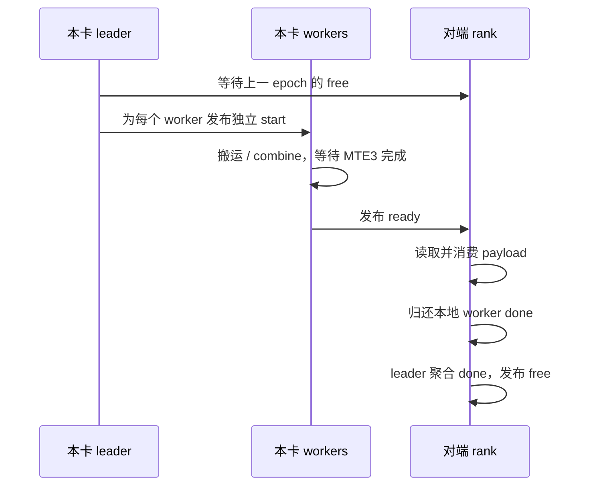

# 910B 上的 DP4/TP2、DP8/TP1 + EP8 自定义通信

设置 `SGLANG_OPT_DSV41_NPU_PEER_COMM=1`，使用 `serve.sh` 的 attention DP4/TP2 或 DP8/TP1、MoE EP8 配置。该开关默认关闭，便于与 HCCL 做同配置 A/B。需要重新构建 native 扩展：

```bash
PYTHONPATH=python build/dsv41-venv/bin/python -m sglang.srt.hardware_backend.npu.dsv41.kernels.build \
  --output build/dsv41 --jobs 4
SGLANG_OPT_DSV41_NPU_PEER_COMM=1 DSV41_ATTN_DP_SIZE=4 \
  bash examples/ascend/deepseek_v41/serve.sh
```

DP8 使用相同开关，设置 `DSV41_ATTN_DP_SIZE=8`（也是 `serve.sh` 的默认值）。第一次 EP gather 传 BF16。原 MXFP4 target 在 router 之后将 shared/routed 输入转为 FP16，routed down 输出 FP16。G32 target 的 routed down 输出 BF16。两种格式的 shared down 输出和 peer 传输的 partial 均为 BF16。

支持同一主机、每进程一张 910B、BF16 ND 张量、hidden=5120。每个 attention DP 的 padded token 行数：DP4/TP2 为 1–128，DP8/TP1 为 1–64；全局通信容量均为 512 行。适用 target verify 和 draft；不是 HTTP request batch 的 1–128。超出范围的张量保留 HCCL。并发 forward / multi-stream 路径保留 HCCL；共享一个 communicator 的 eager 调用与 Graph replay 必须串行，所有 rank 的 collective 顺序一致。

## 三条路径

1. **Attention TP2**：将本地 partial 发布到专用 IPC 区域，两卡各自读取对端 partial，FP32 相加并舍入到 BF16。mHC 边界能够接收延迟完成的 attention 输出时，一个 kernel 完成 SUM、mHC post、collapse 和 RMSNorm。普通调用仍有独立 all-reduce 入口。
2. **MoE 输入 EP8 gather**：DP4 每卡拥有其 DP token 段的一半，DP8 每卡拥有完整本地段。AIV 将这些行通过 HCCS 单播写入八卡各自的 gather 区域，接收方复制本地完整结果。rank 顺序为 DP0/TP0、DP0/TP1、DP1/TP0……。直接写入紧凑的 `[DP*rows,5120]` 布局，不生成通信 padding 后再压紧。
3. **MoE 返回**：route combine 在 FP32 中按原顺序加权，直接将 BF16 partial 写入通信区。每张卡只读取自己负责的 token shard 的八份贡献，按 rank 顺序在 FP32 中求和，再舍入 BF16。shared expert 在这个边界之后只加一次，并再次舍入 BF16。最终只在同一 DP 的 TP2 两卡间恢复行；不产生八卡各自持有完整全局结果的 all-reduce。mHC 后处理直接读取两个 owner 的 shard，能够同时完成 post、collapse 和 RMSNorm。

DP8 返回路径在 route combine 后发布本地 partial。owner 将八份贡献按旋转来源顺序预取到独立 UB 槽（共 80 KiB），以分散读取热点，再严格按 rank 顺序在 FP32 中累加，融合 shared add 和 mHC。转换与累加另外使用 40 KiB UB，合计 120 KiB；无需逐来源执行 Vector→MTE2 同步，也没有 TP2 的输出恢复。DP8 不存在 attention TP all-reduce；draft attention post 使用本地 post/collapse/norm。

MoE 的 FP32 rank 顺序求和与 HCCL 内部 reduction tree 的舍入顺序可能不同；这不是逐 bit 复刻 HCCL。mHC 部分复用现有 native `mhc/state.asc` 算术流水，包括 BF16 中间边界和系数累加顺序。

DSpark 使用独立的 stage runner，也接入相同融合：attention post 同时构造 FFN 的归一化输入；FFN post 返回完整四路 residual 和新的 pre-mix，供后续 draft stage 或输出 head 使用。

## 数据和同步

每组 communicator 的资源由 RuntimeContext 持有。TP2 每卡分配 2 MiB，EP8 每卡分配 8 MiB，均为独立 ACL 分配，避免导出 PyTorch allocator 中同页的其他数据。使用 ACL export key、bare TGID 白名单和带 peer access 的 import。地址表、IPC 映射、编译和 kernel handle 都在 eager warmup 中准备，capture / replay 只发射算子。

每个 peer kernel 固定使用 16 个 AIV worker，并在启动时指定批调度（`schemMode=1`）：等本卡有足够资源再整组调度，避免部分 worker 已经开始轮询、其余 worker 却因争用无法运行。此设置不影响非 peer 算子。

每条控制信号独占 512 字节。设备维护 epoch，Graph replay 不需要 CPU 修改计数。首轮 epoch 为 1；稳定轮次如下：



只有 leader 跨卡检查 free，避免所有 AIV 争用同一控制行。未满足的轮询有短暂退避。payload 读写退休后才发布 done；每个 rank 的所有 worker 都完成后才允许下一轮复用区域。因此不同 shape、gather / return 和融合 kernel 可以共享同一 epoch 序列。未完成的 collective 在设备端超时后 trap，不返回部分结果。

销毁时先退休设备工作，CPU group barrier，关闭全部 import，再 barrier，最后关闭 export 和释放 allocation。必须先退休引用这些地址的 Graph，再销毁 group / RuntimeContext。

## 验证与测量

公共入口在 `sglang.kernels.ops.communication.npu_peer_collectives`；group、缓冲区和延迟输出对象在 `srt.hardware_backend.npu.dsv41.peer_collectives`。

```bash
source /usr/local/Ascend/cann-9.1.0/set_env.sh
peer_native_dir=$(dirname -- "$(readlink -e -- build/dsv41/libdsv41_kernels.so)")
PYTHONPATH=python TASK_QUEUE_ENABLE=0 OMP_NUM_THREADS=1 \
DSV41_NATIVE_DIR="$peer_native_dir" \
  build/dsv41-venv/bin/python -m torch.distributed.run --standalone --nproc-per-node=8 \
  test/manual/kernels/bench_npu_peer_all_reduce.py \
  --stress 1024 --iterations 50 --output build/perf/peer-collectives.json
```

追加 `--attention-tp 1` 验证 DP8 布局；默认 `--attention-tp 2` 验证 DP4。测试同时运行四组 TP2 和一个 EP8，覆盖数值、NaN/Inf、输入拒绝、输出 canary、连续调用、对端延迟到达、非默认 stream、奇数行、不同 shape / collective 交替 replay，以及融合 mHC 的 changed-input replay。mHC 对照使用现有 native 实现；MoE 对照先独立计算各 rank 的 BF16 route combine，再在 CPU 上求和。

微基准在 Graph 内重复完整通信路径，使用 NPU event，七次取中位数，并保留每个 rank 的结果及 immutable library 路径。它排除了 GEMM 和 KV attention，不能替代固定 32K input、总 request batch 1–64 的 target+draft forward A/B。
